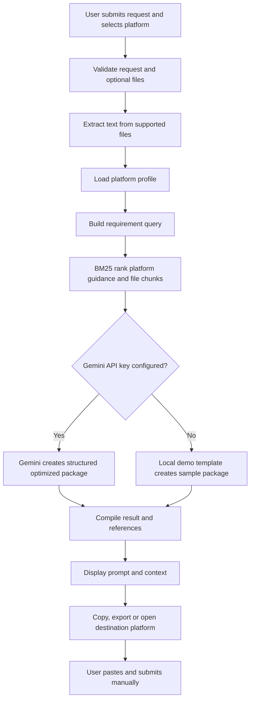

# Samskartha architecture and algorithm

## Three-module architecture

### Module 1 — Input and Requirement Analysis
Receives the original request, target platform and optional context files. Performs input validation, file type and size checks, and initial requirement extraction.

### Module 2 — Prompt and Context Engineering
Loads the target platform profile, retrieves relevant public platform guidance, extracts uploaded text, chunks it, ranks it with BM25, removes duplicate chunks, and calls Gemini to prepare an optimized prompt when configured.

### Module 3 — Package Generation and Output
Returns the prompt, context, references, assumptions, quality notes, and metadata. The browser offers copy, Markdown export, and copy-and-open handoff.

## Sequence

## Retrieval method

The initial retrieval implementation uses BM25 keyword scoring. It is inexpensive and adequate for a small curated profile corpus. It is not semantic vector search. If the corpus grows, add an embedding adapter and compare hybrid ranking against BM25 with a small evaluation set before operating a vector database.

## Trust and privacy

- Platform guidance and user-supplied context are labeled separately.
- User file text is treated as untrusted input.
- Files are processed in memory and not persisted by this starter.
- If Gemini is configured, the selected/retrieved text is sent to the Gemini API for optimization.
- Firestore is optional and only overrides platform profile configuration in this starter.
- Destination GenAI services are opened by the browser; Samskartha does not submit content to them.
